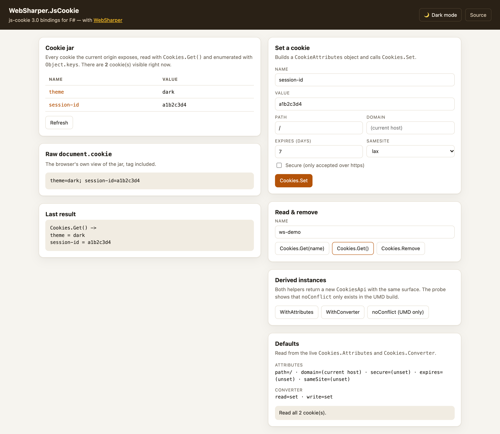

# WebSharper.JsCookie

[](https://www.nuget.org/packages/WebSharper.JsCookie)

WebSharper bindings for [js-cookie](https://github.com/js-cookie/js-cookie) 3.0 —
the small, battle-tested JavaScript API for handling browser cookies, from F# and
C# web apps.

The binding consumes the npm package
[`js-cookie`](https://www.npmjs.com/package/js-cookie) (`>= 3.0.8 < 4.0.0`) and
imports its default export: `import Cookies from "js-cookie"`. There is no global
`Cookies` object and no CDN `<script>`; your bundler (esbuild in the sample)
bundles the package once, and every `Cookies.Set`/`Cookies.Get` call shares it.

> **Release line:** this branch targets **WebSharper 11** and **.NET 11+**. A
> `websharper100` branch with the same surface targets WebSharper 10 and .NET 10.

This repository contains:

| Project | Purpose |
| --- | --- |
| `WebSharper.JsCookie` | The binding: the `Cookies` object, the `CookiesApi` it derives with `WithAttributes`/`WithConverter`, `CookieAttributes`, `Converter` and the `SameSite` enum. |
| `WebSharper.JsCookie.Sample` | A WebSharper SPA (esbuild → `dist/`) that drives the whole bound surface with a light/dark theme switcher. |

## Live demos

**Try it live:** [Open the sample in your browser](https://dotnet-websharper.github.io/js-cookie/)



The sample doubles as the binding's [test case](#running-the-test-case): it sets,
reads and removes cookies with path/domain/expiry/SameSite/Secure attributes,
lists the whole cookie jar, and exercises `WithAttributes`, `WithConverter` and
the `Attributes`/`Converter` readouts.

- **Sample (this repository):** <https://dotnet-websharper.github.io/js-cookie/>
- **Source repository:** <https://github.com/dotnet-websharper/js-cookie>
- **WebSharper bindings:** <https://websharper.com/bindings>

## Features

- `Cookies` (the default import) with `Set`, `Get` (one cookie, or the whole jar),
  `Remove`, `WithAttributes`, `WithConverter`, and the `Attributes`/`Converter`
  readouts.
- `CookiesApi`: the shape `WithAttributes`/`WithConverter` return, with the same
  methods as instance members, so a derived API can be stored and called directly
  (`api.Get(...)`).
- `CookieAttributes`: `Expires` (days as a number, or an absolute `Date`), `Path`,
  `Domain`, `Secure`, `SameSite`, plus a string indexer for arbitrary RFC 6265
  attributes.
- `Converter`: the read/write functions, typed as `(value, name) -> string`.
- `SameSite`: the `strict`/`lax`/`none` string union.
- The whole cookie jar is returned as a string-keyed `CookieMap`.

`noConflict` is deliberately **not** bound: it only exists in the UMD/global build
of the package, not in the ES module a bundler resolves (the type declarations mark
it optional for the same reason). The sample probes `globalThis.Cookies` to show
the distinction.

## Install

```bash
dotnet add package WebSharper.JsCookie
```

Or with Paket:

```fsharp
nuget WebSharper.JsCookie
```

The package targets `netstandard2.0`. It declares the npm dependency
`js-cookie >= 3.0.8 < 4.0.0` (inclusive lower bound, next major exclusive), so
your bundler installs a compatible js-cookie automatically.

## Usage

```fsharp
namespace WebSharper.JsCookie.Demo

open WebSharper
open WebSharper.JavaScript
open WebSharper.JsCookie

[<JavaScript>]
module Demo =

    let demo () =
        // A session cookie on the current path.
        Cookies.Set("theme", "dark") |> ignore

        // A cookie that expires in 7 days, scoped to /docs, SameSite=Lax.
        let attributes =
            CookieAttributes(
                Path = "/docs",
                Expires = 7.,
                SameSite = SameSite.Lax)
        Cookies.Set("locale", "en-GB", attributes) |> ignore

        // Read one cookie, and the whole jar.
        let theme = Cookies.Get("theme")
        let jar = Cookies.Get()
        for name in JavaScript.Object.Keys(As<obj> jar) do
            Console.Log(name, jar.[name])

        // Remove it again (match the path/domain that were used to set it).
        Cookies.Remove("theme")

        // Derived APIs share the same surface.
        let scoped = Cookies.WithAttributes(CookieAttributes(Path = "/api"))
        scoped.Set("token", "abc123") |> ignore
        Console.Log("scoped token:", scoped.Get("token"))

        let decoded =
            Cookies.WithConverter(
                Converter(
                    Read = fun value _ -> value.Replace("enc|", ""),
                    Write = fun value _ -> "enc|" + value))
        decoded.Set("secret", "s3cr3t") |> ignore
```

`Expires` accepts a number of days (`7.`) or a `Date`; both are WIG unions, so
either alternative is assignable directly. `SameSite` likewise accepts the enum
or a positional string.

## Upstream license

The binding's own code is **Apache 2.0** (see [LICENSE.md](LICENSE.md)). The
underlying [`js-cookie`](https://github.com/js-cookie/js-cookie) library is
**MIT** — a permissive license — so consuming the binding adds no
copyleft obligations. See the upstream
[`LICENSE`](https://github.com/js-cookie/js-cookie/blob/master/LICENSE) for the
exact terms.

## Running the test case

The sample is a static SPA. Building it runs `npm install` and esbuild and emits
`dist/` at the repository root:

```bash
dotnet build WebSharper.JsCookie.Sample/WebSharper.JsCookie.Sample.fsproj -c Release
```

Serve it with [dotnet-serve](https://github.com/dotnet-serve/dotnet-serve):

```bash
dotnet tool install -g dotnet-serve   # once
dotnet serve -d dist -p 5287
```

Then open <http://localhost:5287/>. Note that cookies are origin-scoped: they are
created for `localhost` and are visible in your browser's dev tools. The **Secure**
attribute is rejected by the browser over plain HTTP, so it only takes effect on
an HTTPS origin. The sample exercises `Cookies.Set`/`Get`/`Remove`,
`WithAttributes`, `WithConverter` and the `Attributes`/`Converter` readouts, and
shows the whole jar.

## Build from source

Prerequisites: .NET 11 SDK, Node.js (for the sample) and Paket (restored as a
local tool).

```bash
dotnet tool restore
dotnet paket install
dotnet build WebSharper.JsCookie/WebSharper.JsCookie.fsproj -c Release
dotnet build WebSharper.JsCookie.Sample/WebSharper.JsCookie.Sample.fsproj -c Release
```

The build stack entry point is `./build <target>` (`CI-Release`, `WS-Package`,
…), and `WSPackageFolder=/tmp/pkg ./build WS-Package` produces the NuGet package.

## Deployment

`./.github/workflows/ghpages.yml` builds the sample in Release on .NET 11 and
publishes `dist/` to the `gh-pages` branch with
[`peaceiris/actions-gh-pages`](https://github.com/peaceiris/actions-gh-pages)
on **every push to `main`** (and manually via `workflow_dispatch`).

## Repository layout

```
WebSharper.JsCookie/                 the binding (WIG definitions)
  Main.fs
  WebSharper.JsCookie.fsproj
  wsconfig.json
WebSharper.JsCookie.Sample/          the SPA test case
  Client.fs
  index.html
  css/index.css
  esbuild.config.mjs                 esbuild → ../dist
  package.json
  wsconfig.json
docs/sample.png                      real browser capture (light theme)
nuget/                               Paket pack template
build.fsx / build.cmd / build.sh     build-stack entry points
```

## License

Apache 2.0 — see [LICENSE.md](LICENSE.md). The bound `js-cookie` library is MIT.
